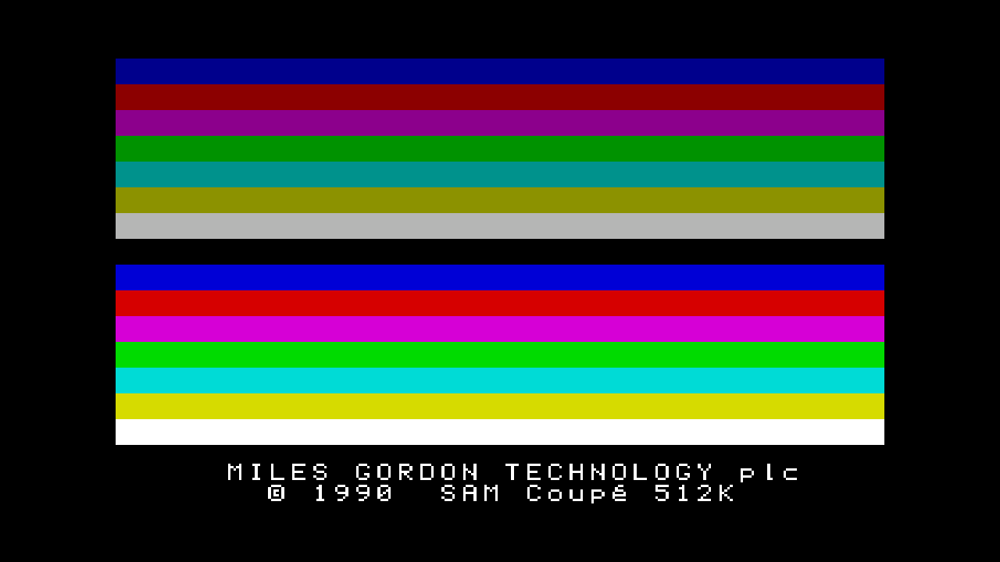
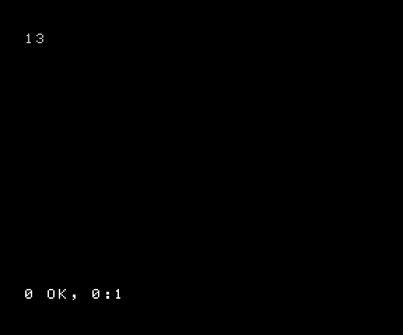
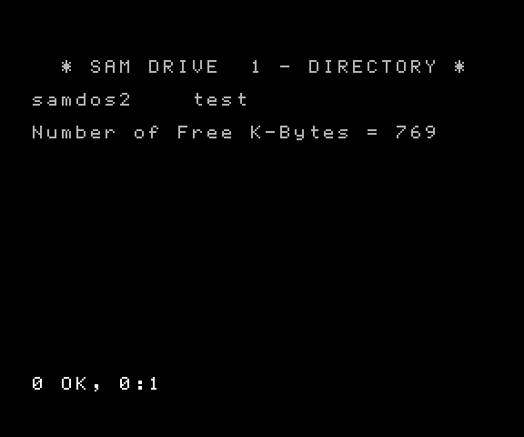
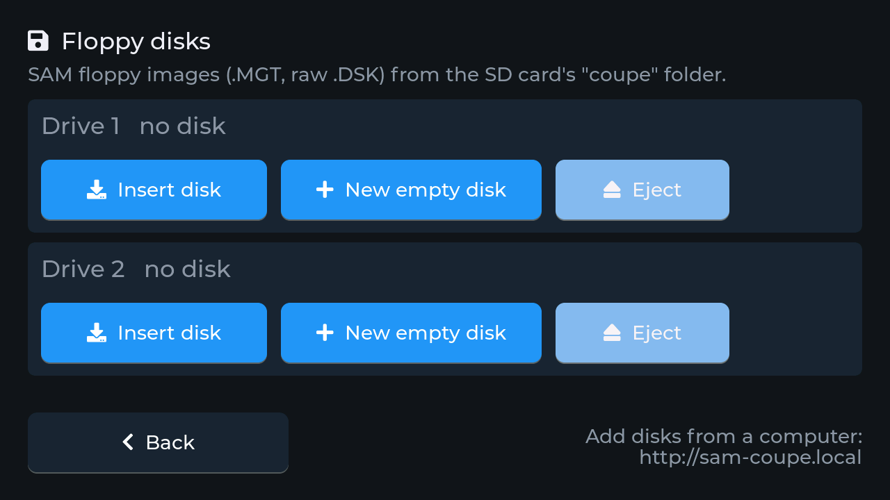

<h1 align="center">esp32coupe</h1>

<p align="center">
  <b>A SAM Coupé on a Makerfabs MaTouch ESP32-S3 7-inch touchscreen or an M5Stack Tab5.</b><br>
  Z80B at approximately 6 MHz, 256 or 512 KiB RAM, all four screen modes, stereo sound,
  and two 3½-inch floppy drives for SAMDOS disk images.
</p>

<p align="center">
  
  
  
  
  
  
</p>

<p align="center">
  <b>Work in progress.</b> The Tab5 has booted ROM v2.4. The MaTouch build and
  the host tests are described below.
</p>

<p align="center">
  
  <br><sub>SAM ROM v2.4, captured directly from the Tab5's LCD.</sub>
</p>

esp32coupe uses the shared [esp32emu](https://github.com/rlucencic/esp32emu)
runtime for the touchscreen, SD card, keyboards, sound output, web page and
serial console. It uses the same Z80 core as
[esp32zx](https://github.com/rlucencic/esp32zx) (ZX Spectrum),
[esp32cpc](https://github.com/rlucencic/esp32cpc) (Amstrad CPC) and
[esp32msx](https://github.com/rlucencic/esp32msx) (MSX).

[esp32oric](https://github.com/rlucencic/esp32oric) (Oric Atmos and Oric-1) uses the same board runtime.

## Features

**The machine**

- **Z80B and selectable 256 or 512 KiB RAM** with 16 KiB paging and a
  user-supplied 32 KiB system ROM. The setup screen remembers the memory choice.
- **All four screen modes**. Modes 1 and 2 use bitmap and attribute memory,
  mode 3 is 512×192 with four colours, and mode 4 is 256×192 with 16 colours.
  The programmable 128-colour palette, border and mode changes are sampled
  by scanline.
- **Stereo sound** from the SAA1099's six tone channels and two noise
  generators, plus the ASIC beeper.
- **HID keyboard**. PC F1–F9 map to the SAM function keys, F10 maps to F0,
  left Alt is Symbol, right Alt is Edit, and keypad Plus is the SAM Plus key.

**Disks**

- Two 1772-style drives with **read/write support** for:
  - raw 800 KiB `.MGT` and `.DSK` images (SAMDOS, MasterDOS: 80 tracks,
    two sides, ten 512-byte sectors per track);
  - raw 720 KiB `.CPM` and `.DSK` images in Pro-DOS's CP/M format (nine
    sectors per track): the Pro-DOS system disk, FDOS and the CP/M
    collection's Infocom games, HiSoft tools and adventures;
  - extended `.DSK` images (EDSK), with any sector IDs and sizes, such as
    the Pro-DOS 1.8 and Pro-DOS Lite boot disks with their three 1 KiB
    sectors a track.
- Mount an image from the SD card through the setup screen or the web page.
  The setup screen can also create blank images for a running SAMDOS session.
- Press **F9** or type `BOOT` with a SAMDOS system disk in Drive 1.
  The [SAMDOS archive](https://www.worldofsam.org/products/samdos) includes
  the original system disks.
- **CP/M through Pro-DOS**: boot a Pro-DOS boot disk with F9, insert the
  system disk in Drive 1 when it asks and press Space, then `B:` for the
  disk in Drive 2. The disks are on the
  [Pro-DOS pages](http://www.samcoupe-pro-dos.co.uk/prodosdisk.html)
  ([CP/M images](http://www.samcoupe-pro-dos.co.uk/cpm_images.html),
  [FDOS](http://www.samcoupe-pro-dos.co.uk/fdos_download.html)); Zork I
  runs from its `.cpm` image.

**Around it**

- **Touchscreen setup** for Bluetooth pairing, Wi-Fi, sound and disks.
  Hold the top-right corner for two seconds to return to setup.
- **Web interface** at `http://sam-coupe.local` when the board is on the
  network. Upload, insert, eject, create and download floppy images, and
  see the machine's state: memory paging, the screen mode with its
  resolution and colours, the palette as swatches, the SAA1099's channels
  (each drive shows its image's kind).

<p align="center">
  
  
  <br><sub>SAM BASIC and a SAMDOS directory from the host build.</sub>
</p>

<p align="center">
  
  <br><sub>The Floppy page on the Tab5.</sub>
</p>

## Hardware

| | Makerfabs MaTouch ESP32-S3 7-inch | M5Stack Tab5 |
|---|---|---|
| Chip | ESP32-S3, 16 MB flash, 8 MB PSRAM | ESP32-P4, 16 MB flash, 32 MB PSRAM |
| Screen | 1024×600 RGB touchscreen | 1280×720 MIPI-DSI touchscreen |
| Storage | microSD | microSD |
| Input | Bluetooth HID keyboard | Bluetooth or USB HID keyboard, or the Tab5 Keyboard |
| Sound | MAX98357A speaker output, when enabled | Built-in speaker |

## Getting started

### 1. What you need

ESP-IDF **5.5.6**, the [esp32emu](https://github.com/rlucencic/esp32emu)
checkout alongside this one, and a 32 KiB SAM Coupé system ROM. See
[ROM setup](roms/README.md) for the two ways to load it. ROM v2.4 was used
for the checks below.

```sh
git clone https://github.com/rlucencic/esp32emu.git
git clone https://github.com/rlucencic/esp32coupe.git
cd esp32coupe
```

### 2. Build and flash

Activate ESP-IDF first. Replace `PORT` with the board's serial port.

```sh
# Makerfabs MaTouch ESP32-S3
idf.py -B build -DIDF_TARGET=esp32s3 -DSDKCONFIG=build/sdkconfig build
idf.py -B build -DIDF_TARGET=esp32s3 -DSDKCONFIG=build/sdkconfig -p PORT flash

# M5Stack Tab5 (ESP32-P4)
idf.py -B build-tab5 -DIDF_TARGET=esp32p4 -DSDKCONFIG=build-tab5/sdkconfig build
idf.py -B build-tab5 -DIDF_TARGET=esp32p4 -DSDKCONFIG=build-tab5/sdkconfig -p PORT flash
```

A local `roms/coupe.rom` present at configure time is included in a full
flash. The runtime prefers `coupe/roms/coupe.rom` on the SD card when it
finds a valid image there. ROM files are supplied separately.

### 3. First start

1. Put disk images in `coupe/` on the microSD card.
2. Pair or connect a keyboard. Use **WiFi** in setup if you want the web page.
3. Choose **256 KB** or **512 KB** under **Memory**, then tap **Start**.
   Press **Enter** at the ROM splash screen for SAM BASIC.
4. To use SAMDOS, mount its system disk in **Drive 1** and press **F9** or type
   `BOOT` in BASIC.

## How it works

| Path | Role |
|---|---|
| `main/main.c` | PSRAM and ROM setup, storage callbacks, and integration with `emu_machine_t` |
| `components/coupe/coupe.c` | Z80 bus, SAM memory paging, keyboard, interrupts and video |
| `components/coupe/floppy.c` | Two floppy register sets; raw MGT and Pro-DOS images and EDSK as tables of sectors |
| `components/coupe/sound.c` | SAA1099 stereo tone and noise mixer and the ASIC beeper |
| `components/coupe/host/` | Standalone host harness using the same machine core |

## Development

```sh
make -C components/coupe/host
components/coupe/host/build/coupe_host roms/coupe.rom 400 screen.ppm
COUPE_KEYS='\nPRINT 6+7\n' components/coupe/host/build/coupe_host roms/coupe.rom 400 basic.ppm
```

An optional final argument mounts an image in Drive 1. In `COUPE_KEYS`,
`\n` sends Enter, `\b` sends F9, and `\w` waits five emulated seconds.
Set `COUPE_MEMORY=256` to boot the base machine. The host defaults to
512 KiB and writes a 576×240 PPM with pixels twice as tall as they are wide.

## Tested so far

- **M5Stack Tab5** booted the flashed v2.4 ROM and displayed the SAM Coupé
  startup screen at 256 and 512 KiB. The Floppy page opened from setup,
  and the board remembered its memory selection after power-on reset.
- **MaTouch** firmware compiled and linked with ESP-IDF 5.5.6. Hardware
  startup is still to be checked.
- **Host** ran SAM BASIC in all four display modes and booted SAMDOS 2.0
  with both memory configurations.
  A BASIC program saved to a copy of the system disk loaded and ran after
  reopening the image.

## Limitations

- Memory contention, interrupts and floppy timings are approximate.
  Video register changes are sampled once per scanline.
- The floppy controller reads and writes sectors and formats tracks (Write
  Track) where the image's layout allows: SAMDOS and Pro-DOS format blank
  800 KiB and 720 KiB images; EDSK tracks keep their number and sizes of
  sectors. The SAD, SDF and TD0 containers still need support.
  [SAMdisk format reference](https://simonowen.com/samdisk/formats/)
- Cassette, MIDI, mouse, external RAM and SAA1099 envelope generators are
  unimplemented. Game and demo compatibility, keyboard input and speaker
  output still need testing on hardware.

## References

- [MGT SAM Coupé Technical Manual](https://github.com/stefandrissen/sam-coupe-technical-manual/blob/main/techmanual.md)
- [MGT SAM Drive Manual](https://www.worldofsam.org/system/files/2018-05/SAM%20Coup%C3%A9%20Sam%20Drive%20Manual.pdf)
- [SAMDOS system disks and format notes](https://www.worldofsam.org/products/samdos)
- [SimCoupe disk image format reference](https://github.com/simonowen/simcoupe/blob/main/Manual.md)

## Licence

[MIT](LICENSE) for the emulator source. The original ROM and system disks
are separate.
